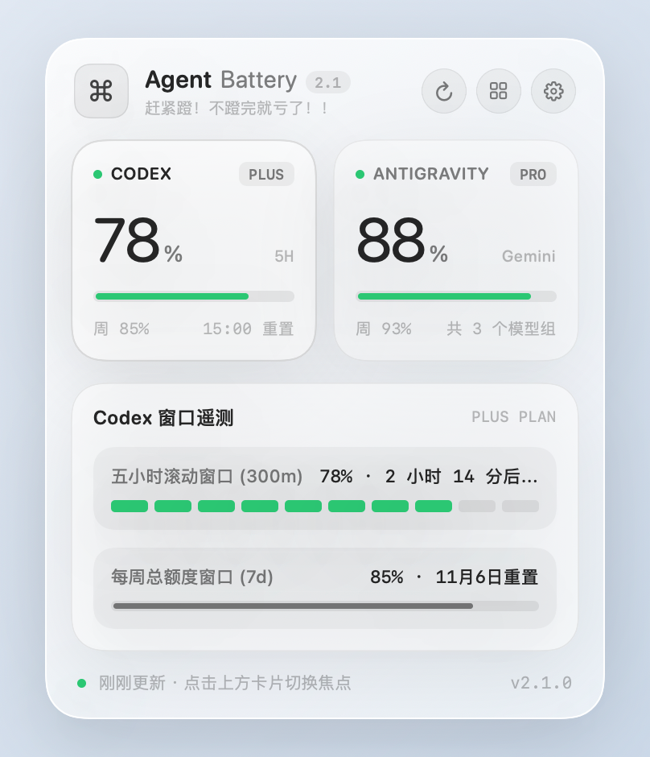
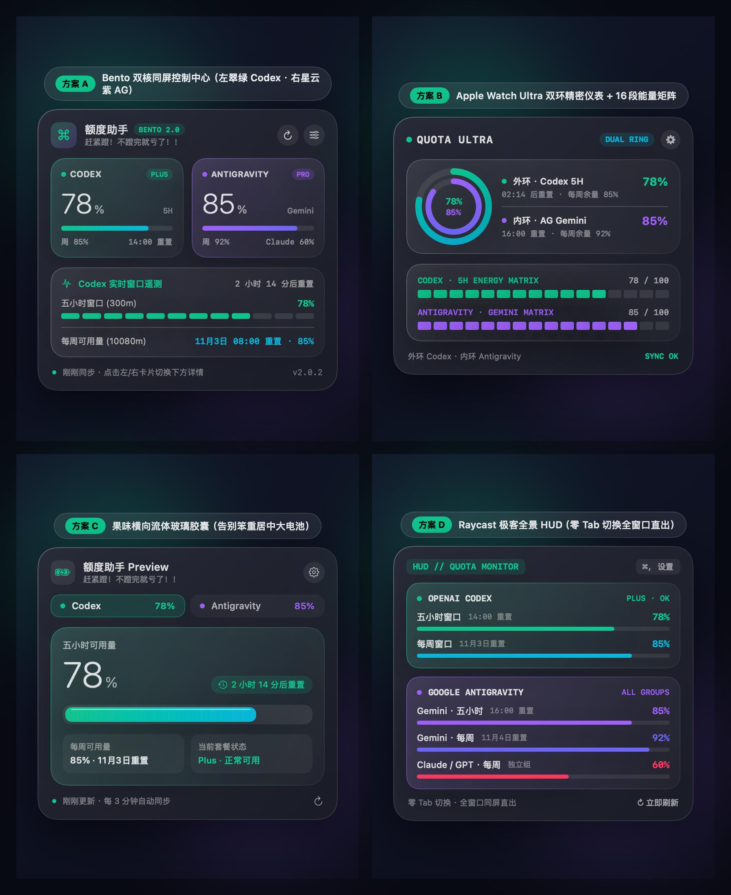
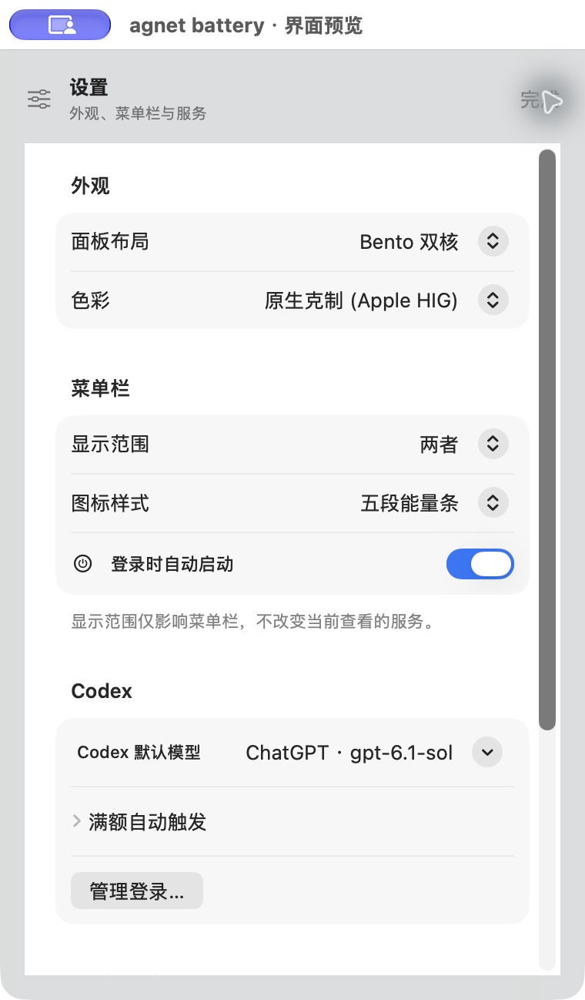

# Agent Battery (Codex Battery) 2.1.0

一个纯原生（AppKit + SwiftUI）、零第三方依赖的 macOS 菜单栏 AI 额度监控工具，同时支持本机登录的 **OpenAI Codex** 与 **Google Antigravity (Gemini CLI / IDE)** 双服务实时配额遥测。非 OpenAI 或 Google 官方产品。

## 界面预览

### 原生克制美学 (Apple HIG Mode · 默认)

遵循 Apple Human Interface Guidelines 的 **Deference（界面谦逊退后）**、**Clarity（黑白灰字体层级）** 与 **90/10 语义色彩法则**——卡片采用无杂色纯净半透明毛玻璃，色彩仅服务于能量刻度本身：



### 内置 4 套面板布局 + 极客双色模式 (Cyber Dual-Tone)

内置 **Bento 双核控制中心**、**Apple Watch Ultra 双环精密仪表**、**果味横向流体胶囊**、**Raycast 极客全景 HUD** 四套 UI 布局，并支持切换「原生克制 (Apple HIG)」与「极客双色 (Cyber Dual-Tone)」色彩体系：





---

## 核心特性

- **双服务同屏监控**：
  - **OpenAI Codex**：自动读取五小时滚动窗口（`300m`）、每周总额度窗口（`10080m`）、套餐类型及服务端重置倒计时。
  - **Google Antigravity**：按模型分组（`Gemini 模型`、`Claude / GPT 模型` 等）展示五小时与每周独立配额，状态栏跟随当前关注组。
- **4 套 UI 布局 × 2 套色彩哲学（即时切换）**：
  - 点击面板右上角 **「⊞ 布局按钮」** 或在 **「⚙️ 偏好设置」** 中一键切换 `Bento 双核` / `Ultra 双环` / `流体胶囊` / `全景 HUD`，以及 `原生克制 (Apple HIG)` / `极客双色` 模式，偏好自动持久化。
- **3 种状态栏显示范围 × 3 款自绘矢量图标**：
  - 支持 **仅 Codex / 仅 Antigravity / 两者同显**。
  - 内置 **能量环 (`ring`)**、**五段能量条 (`bars`)**、**小幽灵 (`ghost`)** 三种纯 `NSBezierPath` 矢量图标。双服务模式下共用单图标（外/内双环、上/下能量条、左/右双幽灵），刷新时提供 0.65 秒轻量微动效。
- **智能轮询与容错缓存**：
  - 正常每 3 分钟自动同步，系统睡眠唤醒自动刷新，五小时窗口到达重置时刻自动触发定点刷新。
  - 短暂网络/限流故障按 `10s -> 30s -> 60s -> 180s` 阶梯退避重试，并在 10 分钟有效期内以 `~` 前缀保留最近一次可信额度。

---

## 数据安全与隐私边界

1. **OpenAI Codex（[`Sources/Quota.swift`](Sources/Quota.swift)）**：
   - 通过本机 `codex app-server --stdio` 完成 `initialize / initialized` 握手并调用 `account/rateLimits/read`。
   - 仅读取额度元数据，不创建会话、不发送模型任务、不读取或复制任何本地认证令牌文件。
2. **Google Antigravity（[`Sources/AGCLI.swift`](Sources/AGCLI.swift) & [`Sources/Antigravity.swift`](Sources/Antigravity.swift)）**：
   - 优先调用本机官方 `/Applications/Gemini.app/Contents/Helpers/agy -p /usage --output-format json` 结构化报告（在沙盒临时目录中禁用自动更新并屏蔽后台弹出浏览器）；若无 CLI 则回退至同用户本地环回 `language_server` 状态查询。
   - 不读取、不复制、不上传任何 OAuth 凭证。

---

## 构建与测试

环境要求：Apple Silicon (`arm64`)，macOS 15.0 及以上，Xcode / Command Line Tools（Swift 5 兼容模式编译，无任何第三方依赖）。

```sh
# 1. 运行完整自动化回归测试（涵盖 Codex 解析、AG 分组隔离、退避恢复、图标渲染与主题持久化）
./test.sh

# 2. 编译并签名生成 Codex Battery.app
./build.sh

# 3. 命令行诊断探针（不启动 GUI，直接输出 JSON 额度摘要）
"Codex Battery.app/Contents/MacOS/CodexBattery" --probe
```

---

## 目录结构

```text
.
├── Sources/
│   ├── App.swift            # NSStatusItem 菜单栏宿主、NSPopover 生命周期与刷新微动效
│   ├── Panel.swift          # SwiftUI 面板视图（4 套主题布局 + Apple HIG / Cyber 双色彩体系）
│   ├── StatusIcon.swift     # 三种自绘矢量状态栏图标、双服务合成渲染与主题枚举持久化
│   ├── Store.swift          # Codex 状态管理、定时轮询与开机自启 (SMAppService)
│   ├── Quota.swift          # Codex stdio JSON-RPC 握手与窗口解析
│   ├── Antigravity.swift    # Antigravity 模型组模型、Store 与本地服务发现
│   ├── AGCLI.swift          # 官方 agy CLI /usage 沙盒调用与解析
│   └── RefreshPolicy.swift  # 缓存新鲜度判定与阶梯退避重试策略
├── Tests/                   # 6 组独立可执行单元与集成回归测试
├── Resources/               # 应用图标资源与生成脚本
├── docs/images/             # README 预览截图
├── Info.plist               # macOS 应用 Bundle 配置
├── build.sh                 # 一键编译、清理扩展属性与 ad-hoc 签名脚本
└── test.sh                  # 一键编译并运行全部测试套件
```

---

## 版本更新记录

- **2.1.0**：
  - 全新升级 `Agent Battery` 视觉体系：遵循 Apple HIG 90/10 色彩克制原则重构默认「原生克制」模式（纯净中性毛玻璃、黑白灰字体层级、语义绿/琥珀能量条），同时保留「极客双色」模式可切换。
  - 内置 `Bento 双核`、`Ultra 双环`、`流体胶囊`、`全景 HUD` 四套可选面板布局。
  - 修复设置页固定高度溢出卡片边界与双标题冲突 Bug，补齐双内凹遥测槽与状态栏刷新过渡动画。
- **2.0.2**：
  - 新增 OpenAI Codex + Google Antigravity 双服务支持与模型分组展示；状态栏支持单服务与双服务合体图标模式。
- **1.1.2**：
  - 修复短暂查询失败即隐藏数字的问题，增加 10 分钟缓存标记、阶梯快速重试与子进程超时强杀保护。
- **1.1.0 - 1.1.1**：
  - 新增能量环、五段能量条、小幽灵三种状态栏矢量图标与偏好设置页。
