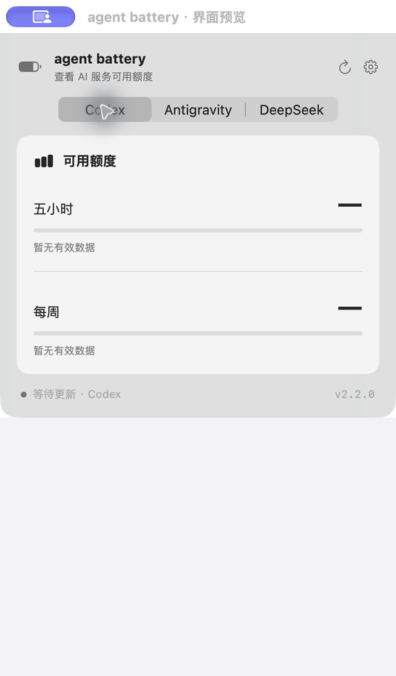
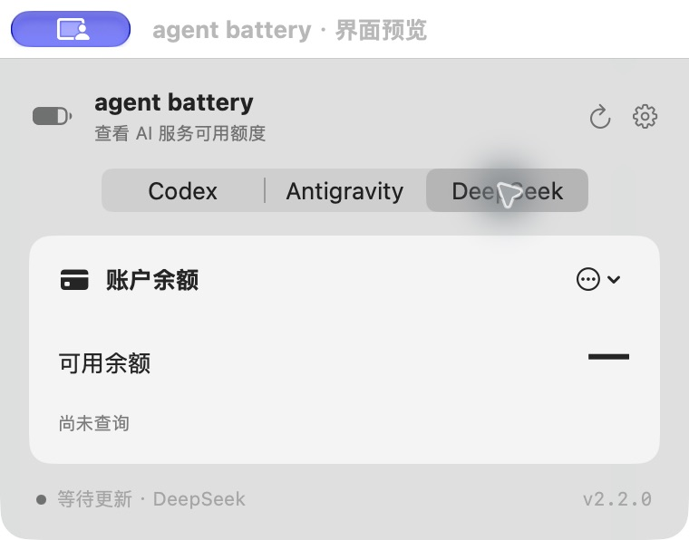

# agent battery 2.2.0

这次更新把 Codex、Antigravity、DeepSeek 整理为三个同级服务，并新增 DeepSeek API 账户余额查询。

## 新增与调整

- **三个同级入口**：顶部切换 Codex / Antigravity / DeepSeek；选中后在主内容区显示对应服务，移除底部附加余额卡片。
- **DeepSeek 余额**：使用官方 `GET /user/balance`，显示可用总额、赠金、充值余额，人民币和美元分别呈现。查询不向模型提问。
- **Key 管理**：DeepSeek 页菜单中配置或更新 Key，保存于 macOS 钥匙串，与已有模型切换功能共用，无需切换当前模型。
- **一致的界面与状态**：沿用卡片材质、文字层级和明细展开方式。刷新按钮、加载指示和底部状态跟随当前服务。未配置、加载、认证失败、限流、网络失败与零余额分开处理。
- **修复极客配色**：默认概览进度条不再固定绿色；Codex 青绿、Antigravity 紫色随选项变化，设置内新增配色预览。低额度继续使用琥珀色。
- **项目文档**：重写使用与安装说明，补充更新记录、安全报告说明、第三方许可和六项 DeepSeek mock 测试。

## 演示

以下为本版本实际运行的本地界面预览。预览不读取钥匙串、不查询账户，未知值显示「—」，没有虚构余额或百分比。动图由界面操作中的实际截图组成。

## 安装与校验

下载 **agent-battery-2.2.0-macos-arm64.zip**，解压后将 App 放入「应用程序」。要求 Apple Silicon、macOS 15+、Python 3.9+；目前没有 Intel 安装包。Codex / Antigravity 需要已安装并登录本机对应服务。

升级前退出旧 App，避免同时运行旧名称副本。沿用旧版 bundle 标识以保留偏好。GitHub 自动生成的 Source code 是源码，不是可直接运行的安装包。

`SHA256SUMS.txt` 与安装包放在同一目录后，执行 `shasum -a 256 -c SHA256SUMS.txt` 检查完整性。本包是本地 ad-hoc 签名，尚未经过 Developer ID 签名和 Apple 公证。

## 使用边界

- DeepSeek 金额目前只在面板显示，菜单栏显示范围仍为 Codex / Antigravity / 两者。
- **Codex 满额自动轻量触发仍默认开启**，会发送真实最小请求并消耗少量套餐额度；可在设置关闭。以前安装的独立 LaunchAgent 需单独停用。
- 模型切换会修改本机 Codex 默认模型配置；DeepSeek 模型调用使用自己的 API 账户计费，余额查询本身不创建模型会话。
- 仓库尚未指定项目许可证，不把公开源码表述为已授予开源许可；第三方库许可见 THIRD_PARTY_NOTICES.md。

## 验证范围

完整 `test.sh` 通过；DeepSeek 六项 mock 测试覆盖金额、币种、缺失数据、认证/网络错误、重定向防护及凭证不出现在输出中。发布 ZIP 解压后通过严格签名校验，源码改动和安装包通过 Gitleaks 扫描。

真实余额检查返回未配置 Key；尚未使用真实 Key 验证成功余额返回，未执行真实模型调用或计费测试。界面实际检查了默认布局的三个入口和设置；其他保留布局尚未逐一完成全状态视觉回归。

完整变化：[v2.1.3…v2.2.0](https://github.com/einsy1/agent-battery/compare/v2.1.3...v2.2.0)
